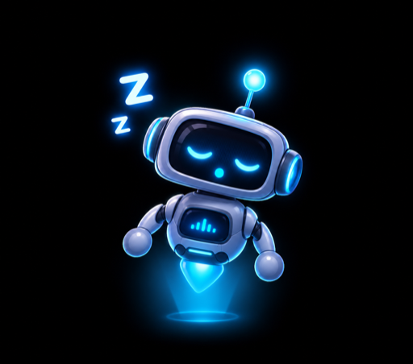
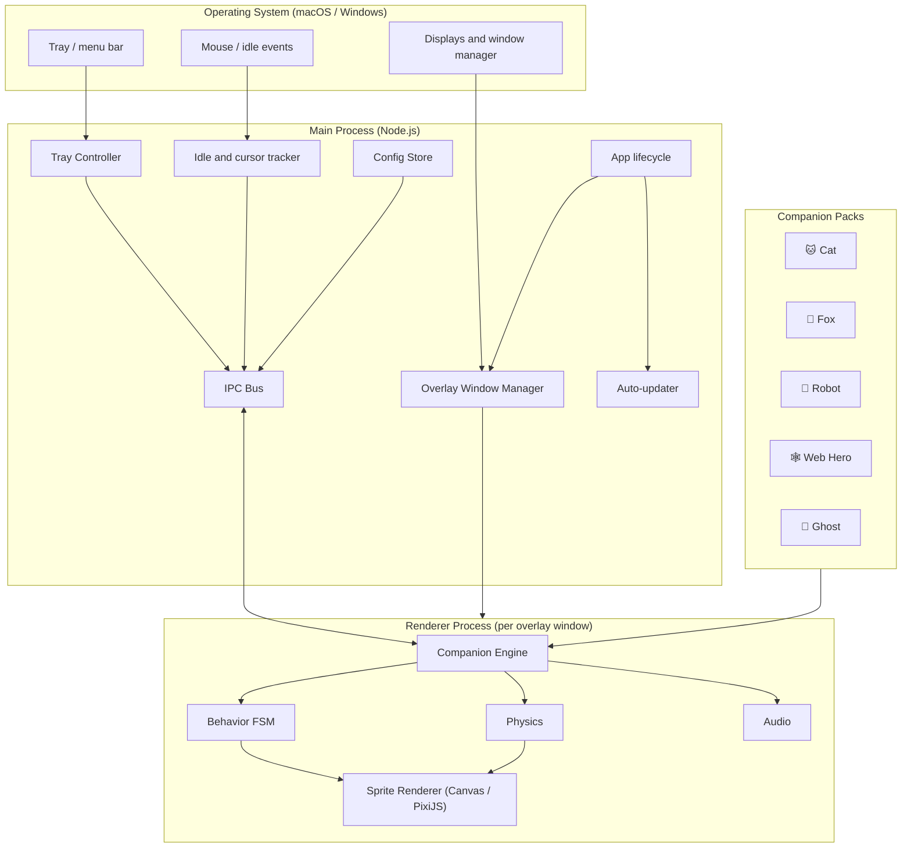

<pre align="center">
 ____            _     ____        _
|  _ \  ___  ___| | __|  _ \ __ _ | |___
| | | |/ _ \/ __| |/ /| |_) / _` || / __|
| |_| |  __/\__ \   < |  __/ (_| || \__ \
|____/ \___||___/_|\_\|_|   \__,_||_|___/
</pre>

<h1 align="center">🐾 DeskPals</h1>

<h3 align="center">Your screen is no longer lonely</h3>

<p align="center"><strong>Tiny animated companions that live on top of everything you do.</strong> Watch YouTube. Chat on WhatsApp. Write code. A cat, a fox, a robot, a web-slinging hero or a ghost hangs out right there with you.</p>

<p align="center">
  
  
  
  
  
</p>

<p align="center">🐱 &nbsp; 🦊 &nbsp; 🤖 &nbsp; 🕸️ &nbsp; 👻</p>

> **Heads up:** "DeskPals" is a placeholder name. Rename it however you like (search and replace `DeskPals` across the repo). Anything marked `TODO` or inside `<angle brackets>` is meant for you to fill in.

---

## 📖 Table of Contents

1. [What is this?](#-what-is-this)
2. [Meet the companions](#-meet-the-companions)
3. [Features](#-features)
4. [Availability: macOS and Windows](#-availability-macos-and-windows)
5. [System requirements](#-system-requirements)
6. [⬇️ Download](#️-download)
7. [Installation](#-installation)
8. [Quick start](#-quick-start)
9. [Controls and interactions](#-controls-and-interactions)
10. [Behavior engine](#-behavior-engine-how-they-think)
11. [Tech stack](#-tech-stack)
12. [Architecture](#-architecture)
13. [Project structure](#-project-structure)
14. [Development setup](#-development-setup)
15. [Building and packaging](#-building-and-packaging)
16. [Configuration reference](#-configuration-reference)
17. [Permissions and privacy](#-permissions-and-privacy)
18. [Performance budget](#-performance-budget)
19. [Adding a new companion](#-adding-a-new-companion)
20. [Troubleshooting](#-troubleshooting)
21. [FAQ](#-faq)
22. [Roadmap](#-roadmap)
23. [Contributing](#-contributing)
24. [License and credits](#-license-and-credits)

---

## ✨ What is this?

DeskPals is a **desktop companion app**. It puts small animated characters in a transparent, always-on-top layer above every other window on your computer. They are not stuck inside an app window. They sit on top of your browser, your chat apps, your editor, whatever you have open.

In practice that looks like this:

- A pink-and-white **cat** parked in the corner of your screen while you browse YouTube.
- A little **ghost** floating over the bottom of a WhatsApp chat, hovering near the message bar.
- A **robot** pacing along the top edge of a window.

You can click them, drag them, pet them, ignore them, or let them wander. They react to your mouse, your idle time and the time of day.

---

## 🎭 Meet the companions

There are **5 companions** in the current release.

<table align="center">
  <tr>
    <td align="center"><br><strong>Cat</strong></td>
    <td align="center"><br><strong>Fox</strong></td>
    <td align="center"><br><strong>Robot</strong></td>
    <td align="center"><br><strong>Web Hero</strong></td>
    <td align="center"><br><strong>Ghost</strong></td>
  </tr>
</table>

| # | Companion | Vibe | Personality | Signature moves |
|---|-----------|------|-------------|-----------------|
| 1 | 🐱 **Cat** | Pink and white, fluffy, judgy | Lazy, curious, occasionally chaotic | Loaf, stretch, grooming, chasing your cursor, knocking things off the taskbar edge, 3 a.m. zoomies |
| 2 | 🦊 **Fox** | Quick, clever, sly | Playful, mischievous, restless | Pounce, tail swish, sneaking along window edges, mouse-hunt dive, curl-up nap |
| 3 | 🤖 **Robot** | Beep-boop, retro-futuristic | Logical, a little awkward, secretly sweet | Scanning sweep, error glitch, antenna wiggle, battery-low slump, dance mode |
| 4 | 🕸️ **Web Hero** | Masked wall-crawler energy | Confident, acrobatic, show-off | Web swing across the screen, wall crawl on window edges, ceiling hang, hero landing pose |
| 5 | 👻 **Ghost** | Cute, translucent, floaty | Shy, mischievous, peek-a-boo | Float, phase through windows, peek from screen edges, boo scare, fade in and out |

### Companion details

#### 🐱 Cat

<p align="center"></p>

- **States:** idle, walk, run, sit, sleep, groom, stretch, pounce, drag, fall, land, happy, annoyed
- **Likes:** your cursor, quiet moments, sitting near the corners of your screen
- **Dislikes:** being picked up for too long
- **Easter egg:** leave your computer idle past midnight and she gets the zoomies.

#### 🦊 Fox

<p align="center"></p>

- **States:** idle, trot, sprint, sneak, pounce, sleep (curled up), tail-wag, drag, fall, land, curious
- **Likes:** chasing the cursor, hiding at window edges
- **Easter egg:** double-click and he does a high leap with a spin.

#### 🤖 Robot

<p align="center"></p>

- **States:** idle, walk, scan, glitch, dance, low-battery, charging, drag, fall, land, beep
- **Likes:** order, clean desktops, being asked to dance
- **Easter egg:** triple-click and it "reboots" with a boot-up animation.

#### 🕸️ Web Hero

<p align="center"></p>

- **States:** idle, crouch, run, jump, web-swing, wall-crawl, ceiling-hang, hero-landing, drag, fall, pose
- **Likes:** swinging between screen edges, dramatic landings
- **Easter egg:** drag him far and release and he shoots a web line back to where you grabbed him.

#### 👻 Ghost

<p align="center"></p>

- **States:** float, drift, peek, hide, boo, fade-out, fade-in, drag, giggle, sleepy
- **Likes:** floating near text boxes and input bars, startling you (gently)
- **Easter egg:** the longer you ignore him, the more translucent he gets, until you click him and he pops back to full opacity.

---

## 🚀 Features

### Core
- 🪟 **Transparent always-on-top overlay.** Companions float above all apps.
- 🖱️ **Click-through by default.** Your mouse passes straight through empty areas, and only the companion's own sprite catches clicks.
- 🧲 **Drag and drop.** Pick them up, throw them, watch them fall and land.
- 🧠 **State-machine AI.** Each companion picks moods and actions on its own.
- 🎞️ **Sprite-sheet animation.** Smooth, lightweight, pixel-perfect.
- 🖥️ **Multi-monitor support.** Companions can walk across screens, with per-display scaling.
- 🔍 **HiDPI and Retina aware.** Crisp on Retina Macs and 4K Windows displays.

### Interaction
- 👆 Click, double-click, triple-click and long-press reactions
- 🐭 Cursor following and cursor chasing
- 🌙 Time-of-day behavior (sleepy at night, energetic in the morning)
- 💤 Idle detection (they nap when you step away)
- 🎒 Window-edge awareness (sit on top of window title bars, with permission)

### Control
- 🧰 System tray / menu bar app with a full menu
- 👥 Run **one or all five** companions at once
- 📏 Adjustable size (50% to 300%)
- 🔇 Optional sound effects, with volume control
- 🛌 "Do Not Disturb" mode: hides companions during full-screen apps and screen sharing
- 🔁 Launch at login
- ⚙️ JSON config plus a settings window

### Under the hood
- 🔒 Fully local, with no account and no network calls required
- 🪶 Low CPU and RAM usage
- 🧩 Modular companion packs, so new characters are easy to add
- 🧪 Tested state machine and physics

---

## 💻 Availability: macOS and Windows

| Platform | Status | Architectures | Package |
|----------|--------|---------------|---------|
| 🍎 **macOS** | ✅ Supported | Apple Silicon (arm64), Intel (x64), Universal | `.dmg`, `.zip` |
| 🪟 **Windows** | ✅ Supported | x64, arm64 | `.exe` installer (NSIS), portable `.zip` |
| 🐧 **Linux** | 🧪 Experimental / planned | x64 | `.AppImage`, `.deb` (see [Roadmap](#-roadmap)) |

### Platform notes

**macOS**
- Uses a transparent, frameless `NSWindow` at a floating window level so it appears above normal windows.
- Runs as a **menu bar app** (no Dock icon by default).
- Appears above full-screen apps and across all Spaces when the "Show on all desktops" option is on.
- Needs **Accessibility permission** only if you enable window-edge interaction.
- The app is **notarized and signed** for release builds, or you may need to right-click, then Open, on first launch for unsigned dev builds.

**Windows**
- Uses a transparent, frameless, always-on-top window with per-pixel click-through.
- Lives in the **system tray** (notification area).
- Works above most apps. Exclusive-fullscreen games may hide it, which is a Windows limitation.
- Windows SmartScreen may warn on unsigned builds. Click **More info, then Run anyway**.

---

## 🧱 System requirements

### To run

| | macOS | Windows |
|--|-------|---------|
| **OS version** | macOS 12 Monterey or later | Windows 10 (build 1903+) or Windows 11 |
| **CPU** | Apple Silicon or Intel (64-bit) | x64 or arm64 |
| **RAM** | 4 GB minimum, 8 GB recommended | 4 GB minimum, 8 GB recommended |
| **Disk** | ~200 MB free | ~200 MB free |
| **GPU** | Any with basic hardware acceleration | Any with basic hardware acceleration |
| **Display** | Any, Retina supported, multi-monitor supported | Any, HiDPI supported, multi-monitor supported |
| **Internet** | Not required | Not required |

### To develop

| Tool | Version |
|------|---------|
| Node.js | 20 LTS or newer |
| npm / pnpm | npm 10+ or pnpm 9+ |
| Git | any recent version |
| Python | 3.x (only needed for some native module builds) |
| **macOS only** | Xcode Command Line Tools (`xcode-select --install`) |
| **Windows only** | Visual Studio Build Tools 2022 ("Desktop development with C++") |

---

## ⬇️ Download

<div align="center">

[](https://github.com/Sunnyth10/Deskpals/releases)
[](https://github.com/Sunnyth10/Deskpals/releases)

<a href="https://github.com/Sunnyth10/Deskpals/releases/latest/download/DeskPals-mac-universal.dmg">
  
</a>
&nbsp;
<a href="https://github.com/Sunnyth10/Deskpals/releases/latest/download/DeskPals-win-x64.exe">
  
</a>

Browse all releases → [github.com/Sunnyth10/Deskpals/releases](https://github.com/Sunnyth10/Deskpals/releases)

</div>

### First launch: what to expect

**🍎 macOS**

Open the `.dmg`, drag **DeskPals** into **Applications**, then launch it.

If macOS says the app is damaged or from an unidentified developer, run this once in Terminal:

```bash
xattr -cr /Applications/DeskPals.app
```

Or go to **System Settings → Privacy & Security → Open Anyway**.

**🪟 Windows**

Run `DeskPals-win-x64.exe` and follow the prompts. DeskPals will appear in your system tray.

Windows SmartScreen may show a warning on unsigned builds. Click **More info → Run anyway**.

---

## 📦 Installation

### Option A: Download a release (easiest)

See [⬇️ Download](#️-download) above for the direct download buttons.

### Option B: Build from source

```bash
git clone https://github.com/Sunnyth10/Deskpals.git
cd deskpals
npm install
npm run dev
```

See [Development setup](#-development-setup) for details.

---

## ⚡ Quick start

1. Launch DeskPals.
2. Look for the 🐾 icon in your **menu bar** (macOS) or **system tray** (Windows).
3. Click it, choose **Companions**, and tick the ones you want.
4. Watch them appear on your screen.
5. Drag one around. Click one. See what happens.

---

## 🎮 Controls and interactions

| Action | Result |
|--------|--------|
| **Single click** | Companion reacts (meow, beep, giggle...) |
| **Double click** | Special trick animation |
| **Triple click** | Easter egg animation |
| **Click and hold, then drag** | Pick the companion up |
| **Release while dragging** | Throw with physics, then fall and land |
| **Long press** | Pet mode (happy animation) |
| **Right click** | Context menu (sleep, size, swap, hide) |
| **Hover near it** | It may look at, follow or chase your cursor |
| **Leave it alone** | It wanders, naps and does its own thing |

### Tray / menu bar menu

- 👥 **Companions:** toggle Cat, Fox, Robot, Web Hero, Ghost
- 📏 **Size:** Small, Medium, Large, Custom
- 🔊 **Sound:** On or Off, volume
- 🌙 **Do Not Disturb:** hide during fullscreen and screen share
- 🖥️ **Monitors:** choose which displays they roam
- 🚀 **Launch at login**
- ⚙️ **Settings...**
- ℹ️ **About**
- ❌ **Quit**

---

## 🧠 Behavior engine (how they think)

Every companion runs a small **finite state machine (FSM)** with weighted random transitions.

```
          ┌──────────┐   idle timer    ┌──────────┐
          │   IDLE   │────────────────▶│  WANDER  │
          └────┬─────┘                 └────┬─────┘
   long idle   │        ▲  arrive/stop      │
               ▼        └────────────────────┘
          ┌──────────┐   user returns   ┌──────────┐
          │  SLEEP   │─────────────────▶│  WAKE    │
          └──────────┘                  └──────────┘

   Any state ── grab ──▶ DRAGGED ── release ──▶ FALLING ──▶ LANDING ──▶ IDLE
   Any state ── cursor near ──▶ CURIOUS ──▶ FOLLOW / CHASE / IGNORE
```

### Inputs that influence behavior
- Cursor position and speed
- Time since last user input (idle time)
- Time of day
- Screen and window geometry
- Mood values (energy, happiness, curiosity)
- Which companions are nearby (they can notice each other)

### Mood system
Each companion tracks three values from 0 to 100:

| Stat | Goes up when | Goes down when |
|------|--------------|----------------|
| ⚡ Energy | You're active, after sleeping | Over time, after lots of running |
| 😊 Happiness | You click and pet them | You ignore them for long periods |
| 🔎 Curiosity | New things appear on screen | Over time |

Moods pick which animations are more likely, so a tired cat naps while an energetic fox sprints.

### Physics
- Gravity and ground detection (the bottom of the screen or the top of a window)
- Throw velocity from your drag speed
- Bounce and squash-and-stretch on landing
- Wall and ceiling attach for the Web Hero

---

## 🛠️ Tech stack

> This is the recommended stack for the project. If yours differs, edit this section to match.

| Layer | Technology | Why |
|-------|-----------|-----|
| **App shell** | [Electron](https://www.electronjs.org/) | One codebase for macOS and Windows, with transparent and click-through windows |
| **Language** | TypeScript | Type safety across main and renderer processes |
| **Rendering** | HTML5 Canvas / [PixiJS](https://pixijs.com/) | Fast sprite rendering at 60 FPS |
| **Animation** | Sprite sheets (PNG + JSON atlas) | Lightweight, artist-friendly |
| **State machine** | [XState](https://xstate.js.org/) (or a custom FSM) | Predictable, testable behavior |
| **UI (settings)** | React + CSS Modules | Quick settings window |
| **Build tool** | Vite + electron-vite | Fast dev and builds |
| **Packaging** | electron-builder | `.dmg`, `.exe`, auto-update support |
| **Storage** | electron-store (JSON) | Simple local config |
| **Audio** | Web Audio API / Howler.js | Optional sound effects |
| **Native bridge** | Node native addons / N-API (optional) | Window-edge detection, idle time |
| **Testing** | Vitest + Playwright | Unit tests and end-to-end |
| **Lint / format** | ESLint + Prettier | Consistency |
| **CI/CD** | GitHub Actions | Build and release both platforms |
| **Code signing** | Apple Developer ID + Windows code-signing cert | Trusted installs |

### Alternative stacks (if you want to swap)
- **Tauri (Rust + WebView):** much smaller installer and lower RAM, but transparent overlay behavior needs more per-OS tuning.
- **Swift (macOS) + C#/WPF (Windows):** best native feel, but two separate codebases.
- **Python + PyQt/PySide:** quick to prototype, heavier to distribute.

---

## 🏗️ Architecture

### High-level diagram



### Process model

- **Main process** owns the app lifecycle, tray icon, config, overlay windows and OS-level queries (cursor position, idle time, displays).
- **Renderer process(es)** run the visual engine. One transparent overlay window is created **per display**, sized to that display's work area.
- **IPC** (typed channels) carries cursor position, config changes and tray commands between processes.

### Overlay window setup (the secret sauce)

Each overlay window is created with roughly these properties:

```ts
new BrowserWindow({
  transparent: true,
  frame: false,
  hasShadow: false,
  resizable: false,
  focusable: false,          // never steals focus from your real apps
  skipTaskbar: true,
  alwaysOnTop: true,
  fullscreenable: false,
  webPreferences: { contextIsolation: true, preload: PRELOAD_PATH },
});

win.setAlwaysOnTop(true, 'screen-saver');           // float above normal windows
win.setVisibleOnAllWorkspaces(true, { visibleOnFullScreen: true }); // macOS Spaces
win.setIgnoreMouseEvents(true, { forward: true });  // click-through
```

### Click-through logic

The window ignores mouse events by default. The renderer watches the forwarded mouse-move events and checks whether the cursor is over a **non-transparent sprite pixel**. If so, it asks the main process to briefly turn click-through **off** so that you can click or drag the companion. When the cursor leaves the sprite, click-through turns back **on**.

### Game loop

```
requestAnimationFrame
   ├── read inputs (cursor, idle)
   ├── update FSM (choose state/transition)
   ├── step physics (gravity, collisions, velocity)
   ├── advance animation frame
   └── render to canvas
```

Target: **60 FPS while active**, throttled to **~10 FPS while sleeping or hidden** to save battery.

### Companion pack format

Each companion is a self-contained folder:

```
assets/companions/cat/
├── manifest.json        # name, size, states, personality weights
├── spritesheet.png      # all animation frames
├── atlas.json           # frame coordinates
├── behavior.json        # transition weights and mood rules
└── sounds/              # optional sfx
```

Example `manifest.json`:

```json
{
  "id": "cat",
  "name": "Cat",
  "version": "1.0.0",
  "frameSize": [64, 64],
  "defaultScale": 1.5,
  "personality": { "energy": 0.4, "curiosity": 0.8, "mischief": 0.6 },
  "states": ["idle", "walk", "run", "sit", "sleep", "groom", "pounce", "drag", "fall", "land"]
}
```

---

## 📁 Project structure

```
deskpals/
├── package.json
├── electron-builder.yml
├── vite.config.ts
├── tsconfig.json
├── README.md
├── LICENSE
├── .github/
│   └── workflows/
│       ├── build.yml          # CI build for macOS + Windows
│       └── release.yml        # tag → signed release
├── build/
│   ├── icon.icns              # macOS icon
│   ├── icon.ico               # Windows icon
│   └── entitlements.mac.plist
├── src/
│   ├── main/
│   │   ├── index.ts           # app entry
│   │   ├── overlay.ts         # overlay window manager
│   │   ├── tray.ts            # tray / menu bar
│   │   ├── config.ts          # electron-store wrapper
│   │   ├── idle.ts            # idle + cursor tracking
│   │   ├── displays.ts        # multi-monitor handling
│   │   └── updater.ts         # auto-update
│   ├── preload/
│   │   └── index.ts           # contextBridge API
│   ├── renderer/
│   │   ├── overlay/
│   │   │   ├── engine.ts      # main loop
│   │   │   ├── companion.ts   # companion class
│   │   │   ├── fsm.ts         # behavior state machine
│   │   │   ├── physics.ts     # gravity, throw, collisions
│   │   │   ├── sprite.ts      # sprite/atlas renderer
│   │   │   ├── hitTest.ts     # pixel-perfect hit testing
│   │   │   └── audio.ts       # sound effects
│   │   └── settings/          # React settings window
│   └── shared/
│       ├── types.ts
│       └── ipc-channels.ts
├── assets/
│   └── companions/
│       ├── cat/
│       ├── fox/
│       ├── robot/
│       ├── web-hero/
│       └── ghost/
├── tests/
│   ├── fsm.test.ts
│   ├── physics.test.ts
│   └── e2e/
└── docs/
    └── screenshots/
```

---

## 🧑‍💻 Development setup

```bash
# 1. Clone
git clone https://github.com/Sunnyth10/Deskpals.git
cd deskpals

# 2. Install dependencies
npm install

# 3. Run in dev mode (hot reload)
npm run dev

# 4. Run tests
npm test

# 5. Lint and type-check
npm run lint
npm run typecheck
```

### Useful scripts

| Script | What it does |
|--------|--------------|
| `npm run dev` | Start the app with hot reload |
| `npm run build` | Compile main, preload and renderer |
| `npm run package` | Build installers for your current OS |
| `npm run package:mac` | Build macOS `.dmg` (universal) |
| `npm run package:win` | Build Windows `.exe` installer |
| `npm test` | Run unit tests |
| `npm run test:e2e` | Run end-to-end tests |
| `npm run lint` | ESLint |
| `npm run typecheck` | `tsc --noEmit` |
| `npm run sprites` | Rebuild atlas JSON from raw frames (TODO) |

### Debug flags

```bash
DESKPALS_DEBUG=1 npm run dev      # draws hitboxes, shows FSM state above each companion
DESKPALS_FPS=1  npm run dev       # FPS counter
DESKPALS_ONLY=cat npm run dev     # spawn a single companion
```

---

## 📦 Building and packaging

### macOS

```bash
npm run package:mac
```

Produces in `dist/`:
- `DeskPals-<version>-universal.dmg`
- `DeskPals-<version>-universal-mac.zip`

For distribution you need:
- An **Apple Developer** account
- A **Developer ID Application** certificate
- **Notarization** credentials (`APPLE_ID`, `APPLE_APP_SPECIFIC_PASSWORD`, `APPLE_TEAM_ID`)

### Windows

```bash
npm run package:win
```

Produces in `dist/`:
- `DeskPals-Setup-<version>.exe` (NSIS installer)
- `DeskPals-<version>-portable.zip`

For distribution you should have a **code-signing certificate** (OV or EV) to avoid SmartScreen warnings.

### CI/CD

GitHub Actions builds on `macos-latest` and `windows-latest` runners. Pushing a tag like `v1.0.0` triggers a signed release with attached installers.

---

## ⚙️ Configuration reference

Settings are stored as JSON.

| OS | Location |
|----|----------|
| macOS | `~/Library/Application Support/DeskPals/config.json` |
| Windows | `%APPDATA%\DeskPals\config.json` |

```json
{
  "companions": {
    "cat":      { "enabled": true,  "scale": 1.5 },
    "fox":      { "enabled": false, "scale": 1.5 },
    "robot":    { "enabled": false, "scale": 1.5 },
    "web-hero": { "enabled": false, "scale": 1.5 },
    "ghost":    { "enabled": true,  "scale": 1.5 }
  },
  "sound": { "enabled": false, "volume": 0.4 },
  "launchAtLogin": true,
  "doNotDisturb": { "hideOnFullscreen": true, "hideOnScreenShare": true },
  "displays": "all",
  "followCursor": true,
  "windowEdgeInteraction": false,
  "showOnAllDesktops": true,
  "idleSleepAfterSeconds": 300,
  "maxFps": 60
}
```

---

## 🔐 Permissions and privacy

DeskPals is built to be **private and local**.

- ❌ No account or sign-in
- ❌ No analytics or telemetry
- ❌ No screen recording or screenshots
- ❌ No keyboard logging
- ✅ Everything runs on your machine

| Permission | Needed for | Required? |
|-----------|-----------|-----------|
| Cursor position | Following and chasing the mouse | Yes (no special permission) |
| Idle time | Sleeping when you're away | Yes (no special permission) |
| **macOS Accessibility** | Sitting on top of other windows' title bars | Optional |
| Launch at login | Starting with your computer | Optional |
| Network | Auto-update checks only | Optional (can be disabled) |

---

## 📊 Performance budget

| Metric | Target |
|--------|--------|
| CPU (1 companion, active) | under 3% |
| CPU (sleeping) | under 1% |
| RAM (1 companion) | under 150 MB |
| RAM (all 5) | under 300 MB |
| Frame rate | 60 FPS active, ~10 FPS idle |
| Startup time | under 2 seconds |
| Installer size | ~100 MB (Electron) |

Tips if it feels heavy: lower `maxFps`, disable unused companions and turn off window-edge interaction.

---

## ➕ Adding a new companion

1. Create a folder: `assets/companions/<your-companion>/`
2. Draw your sprite sheet (recommended **64×64** frames, transparent PNG).
3. Create `atlas.json` mapping state names to frame ranges.
4. Write `manifest.json` and `behavior.json`.
5. Register it in `src/shared/types.ts` (the `CompanionId` union).
6. Add it to the tray menu list.
7. Run `DESKPALS_ONLY=<your-companion> npm run dev` to test it alone.

**Minimum required states:** `idle`, `walk`, `drag`, `fall`, `land`, `sleep`.

---

## 🩹 Troubleshooting

| Problem | Fix |
|---------|-----|
| **Nothing appears on screen** | Check the tray icon, open Companions and make sure at least one is ticked. |
| **macOS says the app is damaged or from an unidentified developer** | Right-click the app, choose Open. Or go to System Settings → Privacy & Security → Open Anyway. |
| **Companion doesn't show above full-screen apps (macOS)** | Turn on "Show on all desktops" in Settings. |
| **Can't click apps behind the companion** | Make sure click-through is on (default). Try restarting the app. |
| **Companion is blurry** | Set the size to a whole multiple (1×, 2×, 3×). Check display scaling. |
| **High CPU usage** | Lower `maxFps` to 30, disable extra companions. |
| **Hidden in games (Windows)** | Exclusive fullscreen games hide overlays. Use borderless windowed mode. |
| **SmartScreen warning (Windows)** | Click More info, then Run anyway, or use a signed build. |
| **Companion stuck off-screen** | Tray menu → Reset positions. |
| **Doesn't start at login** | Toggle "Launch at login" off and on again. |

---

## ❓ FAQ

**Does it slow down my computer?**
Barely. See the [performance budget](#-performance-budget).

**Will it block my mouse clicks?**
No. Only the companion's own pixels are clickable.

**Does it work over full-screen apps?**
On macOS, yes (with the Spaces option on). On Windows, it works over borderless-windowed apps but not exclusive fullscreen.

**Will it show up in screen recordings and screen shares?**
It may, since it is a real window. Turn on Do Not Disturb to auto-hide it during screen sharing.

**Can I run all five at once?**
Yes. They can even notice each other.

**Is there a mobile version?**
No, desktop only for now.

**Is it free?**
Yes, open source under the MIT license.

**Can I make my own companion?**
Yes. See [Adding a new companion](#-adding-a-new-companion).

---

## 🗺️ Roadmap

- [x] Cat 🐱
- [x] Fox 🦊
- [x] Robot 🤖
- [x] Web Hero 🕸️
- [x] Ghost 👻
- [x] macOS support
- [x] Windows support
- [ ] Linux support (X11 and Wayland)
- [ ] Companions interacting with each other (chase, play, share a nap)
- [ ] Sit on window title bars and climb window edges
- [ ] Reactions to what you're doing (typing, music, video)
- [ ] Seasonal and holiday outfits 🎃🎄
- [ ] Feeding and care mini-game
- [ ] Companion marketplace and community packs
- [ ] Custom sprite importer
- [ ] Voice reactions
- [ ] Optional AI chat mode (opt-in)
- [ ] Auto-update channel (stable and beta)

---

## 🤝 Contributing

Contributions are welcome, from bug fixes to brand new companions.

1. Fork the repo
2. Create a branch: `git checkout -b feature/my-cool-thing`
3. Commit: `git commit -m "feat: add my cool thing"`
4. Push: `git push origin feature/my-cool-thing`
5. Open a Pull Request

**Guidelines**
- Run `npm run lint && npm run typecheck && npm test` before opening a PR.
- Follow [Conventional Commits](https://www.conventionalcommits.org/).
- For new companions, include the sprite sheet source file and a short GIF preview.

---

## 📜 License and credits

Released under the **MIT License**. See [`LICENSE`](./LICENSE).

**Credits**
- Pixel art and animation: `<your name>`
- Code: `<your name>` and contributors
- Built with Electron, TypeScript, PixiJS and a lot of caffeine ☕

---

<div align="center">

### Made with 💜 for everyone who has ever wanted a tiny friend on their screen.

🐱 🦊 🤖 🕸️ 👻

**If DeskPals made you smile, drop a ⭐ on the repo!**

</div>
